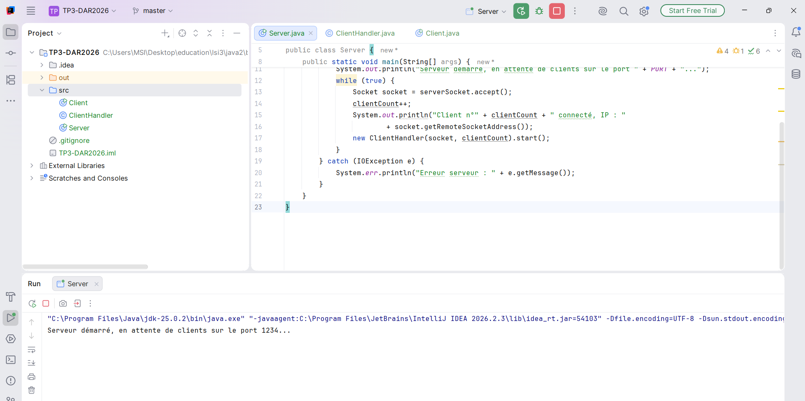
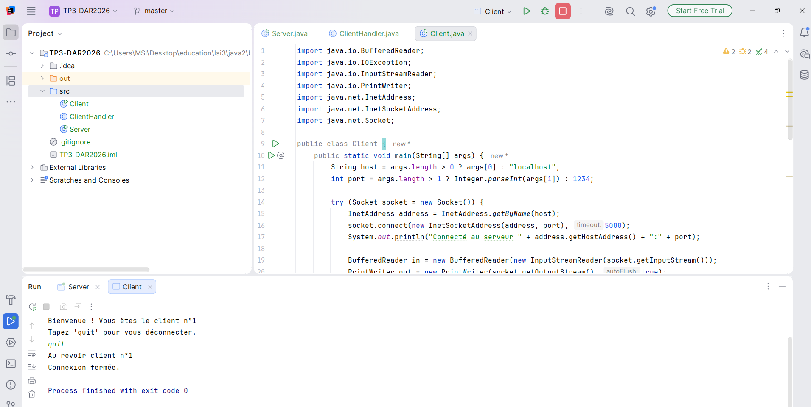
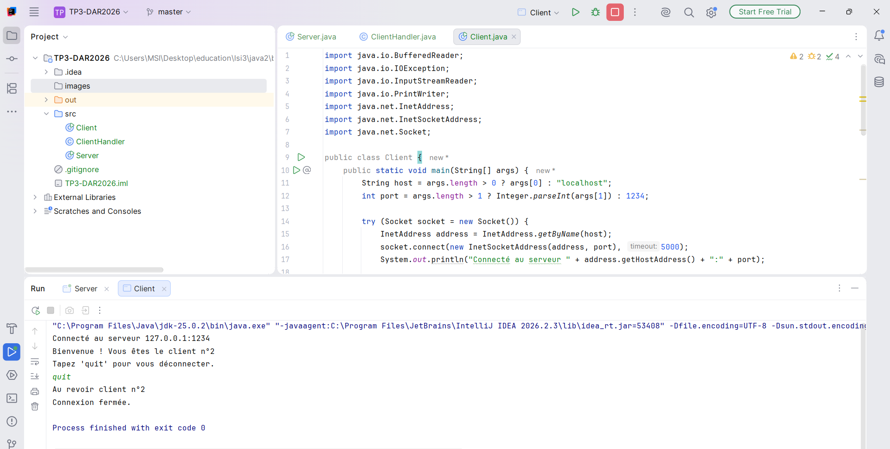
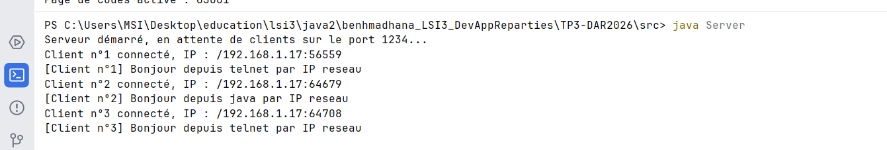
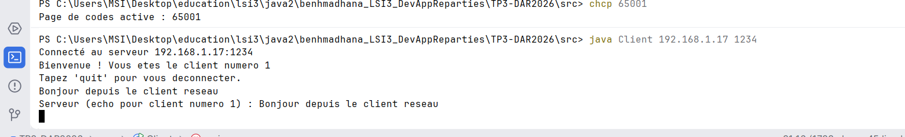
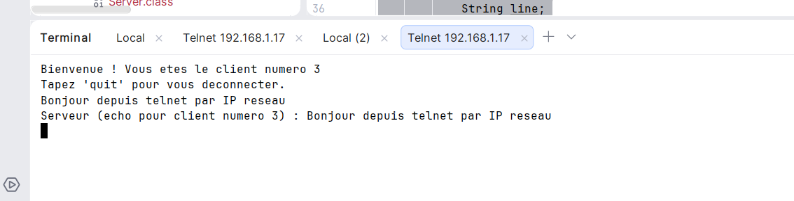
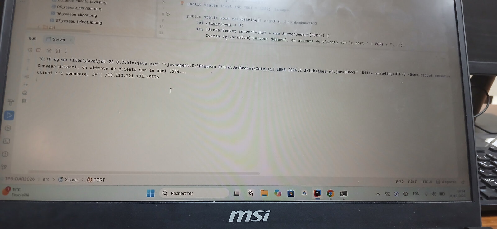
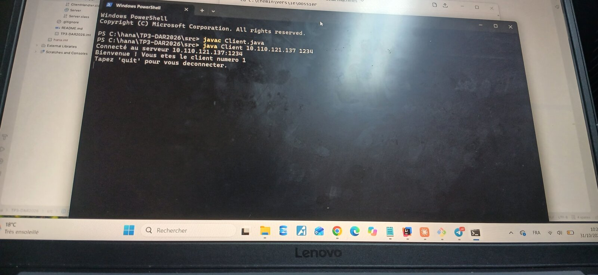

# TP3-DAR2026 : Serveur multi-threads (sockets TCP)

> **Activité 3-1 : Acceptation de plusieurs clients**
> Matière : Développement d'applications réparties, LSI 3
> Faculté des Sciences de Sfax, Département d'informatique et des Communications
> Année universitaire : 2026 – 2027

| | |
|---|---|
| **Étudiante** | Hana Ben Hmad |
| **Enseignante des TPs** | Zeineb Daoud |
| **Responsable du cours** | Amal Abid |
| **Langage** | Java (JDK 25, compatible JDK 8+) |
| **Environnement** | IntelliJ IDEA |
| **Répertoire de travail** | `benhmadhana_LSI3_DevAppReparties` |

---

## Table des matières
1. [Objectif](#1-objectif)
2. [Architecture du projet](#2-architecture-du-projet)
3. [Fonctionnement](#3-fonctionnement)
4. [Compilation et exécution](#4-compilation-et-exécution)
5. [Tests et résultats](#5-tests-et-résultats)
6. [Synthèse](#6-synthèse)

---

## 1. Objectif

Les applications Client/Serveur des TP1 et TP2 ne géraient qu'un seul client par exécution du serveur.
Cette activité les améliore pour obtenir un **serveur multi-threads** capable de traiter **plusieurs clients simultanément** avec les sockets TCP en Java.

Fonctionnalités réalisées :
- Acceptation de plusieurs clients en parallèle (un thread par client)
- Affichage côté serveur de l'**adresse IP** et du **numéro d'ordre de connexion** de chaque client
- Envoi à chaque client de son **numéro d'ordre**
- Compatibilité avec des clients **Telnet** et des clients **Java**
- Client Java paramétrable avec l'adresse IP du serveur (`InetAddress`, `InetSocketAddress`)

---

## 2. Architecture du projet

```
TP3-DAR2026/
├── src/
│   ├── Server.java          # Point d'entrée du serveur, boucle d'acceptation
│   ├── ClientHandler.java   # Thread de communication avec un client
│   └── Client.java          # Client Java TCP
├── images/                  # Captures d'écran des tests
├── .gitignore
└── README.md
```

| Classe | Rôle |
|---|---|
| `Server` | Écoute sur le port **1234**, accepte les connexions, incrémente le compteur de clients, affiche l'IP du client via `getRemoteSocketAddress()` et lance un `ClientHandler` |
| `ClientHandler` | Hérite de `Thread`. Envoie le numéro d'ordre au client, puis renvoie en écho chaque message reçu. La commande `quit` ferme la session |
| `Client` | Se connecte au serveur (`localhost:1234` par défaut, ou IP et port passés en arguments) avec `InetAddress` et `InetSocketAddress`, et gère l'envoi et la réception en parallèle |

---

## 3. Fonctionnement

```
  Client 1 ──┐
  Client 2 ──┼──► Server (accept) ──► ClientHandler n°1 (thread)
  Client 3 ──┘                    ├─► ClientHandler n°2 (thread)
                                  └─► ClientHandler n°3 (thread)
```

1. Le serveur appelle `accept()` en boucle et se met en attente d'une connexion.
2. À chaque connexion, il incrémente `clientCount`, affiche l'IP et le numéro du client, puis crée un `ClientHandler`.
3. Le thread `ClientHandler` dialogue avec son client, ce qui libère le serveur pour accepter immédiatement le client suivant.
4. Les clients sont traités indépendamment : un client lent ou bloqué n'empêche pas les autres de communiquer.

**Boucle principale du serveur (`Server.java`) :**

```java
Socket socket = serverSocket.accept();
clientCount++;
System.out.println("Client n°" + clientCount + " connecté, IP : "
        + socket.getRemoteSocketAddress());
new ClientHandler(socket, clientCount).start();
```

**Connexion du client avec une adresse IP paramétrable (`Client.java`) :**

```java
String host = args.length > 0 ? args[0] : "localhost";
int port = args.length > 1 ? Integer.parseInt(args[1]) : 1234;

InetAddress address = InetAddress.getByName(host);
socket.connect(new InetSocketAddress(address, port), 5000);
```

**Message envoyé à chaque client (`ClientHandler.java`) :**

```java
out.println("Bienvenue ! Vous etes le client numero " + clientNumber);
```

---

## 4. Compilation et exécution

**Prérequis :** JDK 8 ou supérieur.

```bash
# Compilation
cd src
javac -encoding UTF-8 *.java

# 1. Lancer le serveur
java Server

# 2. Lancer un ou plusieurs clients Java (autres terminaux)
java Client                       # serveur local (localhost:1234)
java Client 192.168.1.17 1234     # serveur désigné par son IP et son port

# 3. Ou utiliser Telnet
telnet localhost 1234
```

Pour afficher correctement les accents dans la console Windows, lancer `chcp 65001` avant `java`.
Pour se déconnecter, taper `quit` dans le client.

---

## 5. Tests et résultats

### 5.1 Démarrage du serveur
Le serveur démarre et attend les connexions sur le port 1234.



### 5.2 Connexion d'un client Java
Le client se connecte au serveur et reçoit son numéro d'ordre de connexion.



### 5.3 Plusieurs clients Java simultanés
Plusieurs clients sont connectés en même temps. Le serveur affiche pour chacun son numéro d'ordre et son adresse IP.




### 5.4 Test avec l'adresse IP réseau
Faute de seconde machine physique, le test a été réalisé sur une seule machine en utilisant son adresse IP réseau (`192.168.1.17`, obtenue avec `ipconfig`) à la place de `localhost`, avec plusieurs clients Java et un client Telnet simultanés :

```
java Client 192.168.1.17 1234
telnet 192.168.1.17 1234
```

Le serveur affiche l'adresse IP réelle des clients (`/192.168.1.17:port`) et non plus `[0:0:0:0:0:0:0:1]`, avec leur numéro d'ordre.

**Côté serveur** (trois clients connectés simultanément) :



**Client Java** (client n°2) :



**Client Telnet** (client n°3) :



> **Limite :** un test avec une seconde machine physique (téléphone ou autre PC) n'a pas pu être finalisé : la connexion a été bloquée par la configuration du réseau et du pare-feu. Le client Java est néanmoins prêt pour ce scénario grâce à `InetAddress` et `InetSocketAddress` : il suffit de lancer `java Client <IP_du_serveur> 1234`.

### 5.5 Test entre deux machines physiques différentes
Le test a ensuite été réalisé avec **deux ordinateurs distincts** connectés au même réseau : le serveur tourne sur une première machine (MSI, depuis IntelliJ IDEA) et le client Java sur une seconde machine (Lenovo, depuis PowerShell). Le client est lancé avec l'adresse IP de la machine serveur :

```
java Client 10.110.121.137 1234
```

**Machine serveur** (MSI) : le serveur est en attente sur le port 1234, puis affiche la connexion du client n°1 avec l'adresse IP de l'autre machine (`/10.110.121.101:49376`) :



**Machine client** (Lenovo) : le client se connecte au serveur `10.110.121.137:1234` et reçoit son numéro d'ordre :



Ce test confirme que le serveur accepte des connexions provenant d'une **autre machine** du réseau et identifie le client par sa véritable adresse IP (`10.110.121.101`, différente de celle du serveur `10.110.121.137`).

### Récapitulatif

| Test | Résultat |
|---|---|
| Connexion d'un client Java | Réussi |
| Plusieurs clients Java simultanés | Réussi |
| Affichage de l'IP et du numéro d'ordre côté serveur | Réussi |
| Envoi du numéro d'ordre à chaque client | Réussi |
| Clients Java et Telnet via l'IP réseau (192.168.1.17) | Réussi |
| Test avec une seconde machine physique | Réussi |

> **Remarque :** en local (`localhost`), l'adresse du client s'affiche en IPv6 (`/[0:0:0:0:0:0:0:1]:port`). Avec l'IP réseau, elle s'affiche en IPv4 (`/192.168.1.17:port`).

---

## 6. Synthèse

Dans cette activité, j'ai transformé le serveur mono-client en **serveur multi-threads**. Le serveur boucle sur `accept()` et, pour chaque connexion, incrémente un compteur et crée un thread `ClientHandler` qui dialogue avec ce client. Les clients sont ainsi traités simultanément, sans se bloquer les uns les autres.

Côté serveur, l'adresse IP de chaque client est affichée avec `getRemoteSocketAddress()`, ainsi que son numéro d'ordre de connexion. Chaque client reçoit également son numéro d'ordre. Le compteur `clientCount` n'est modifié que par le thread principal (celui de `accept()`), il n'y a donc pas d'accès concurrent à cette variable.

Les tests locaux avec plusieurs clients Java et plusieurs clients Telnet ont confirmé le bon fonctionnement du serveur. Le client Java utilise `InetAddress` et `InetSocketAddress`, ce qui permet de cibler l'adresse IP d'un serveur. Le test avec l'adresse IP réseau de la machine (`192.168.1.17`) montre que le serveur reçoit bien des connexions autres que `localhost` et identifie les clients par leur adresse réelle.

**Points d'attention rencontrés :**
- Telnet n'est pas activé par défaut sous Windows et doit être activé dans les fonctionnalités Windows.
- Les caractères accentués s'affichaient mal dans la console `cmd` (encodage). Les messages envoyés par le serveur aux clients ont donc été écrits sans accents, et la commande `chcp 65001` est utilisée pour l'affichage console.
- Un seul serveur peut utiliser le port 1234 à la fois : lancer un second serveur provoque l'erreur `Address already in use: bind`.
- Pour un test entre plusieurs machines, le réseau Wi-Fi doit être en profil « Privé » et le port 1234 doit être autorisé dans le pare-feu de la machine serveur (règle `netsh advfirewall`, à créer dans un terminal administrateur). Certains routeurs isolent aussi les appareils Wi-Fi entre eux, ce qui peut bloquer la connexion.